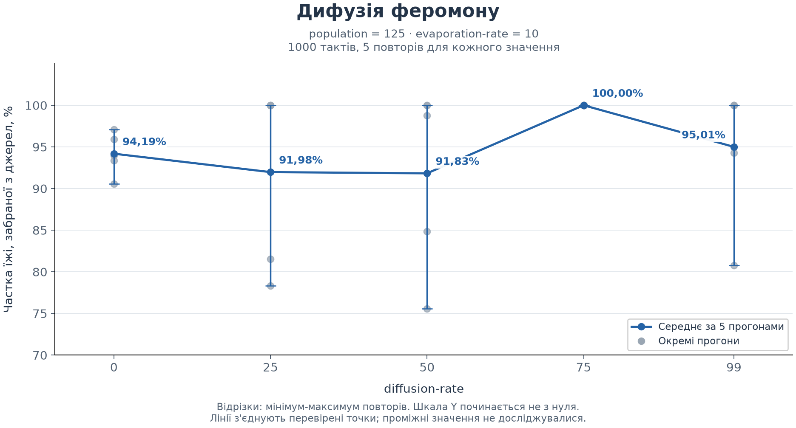
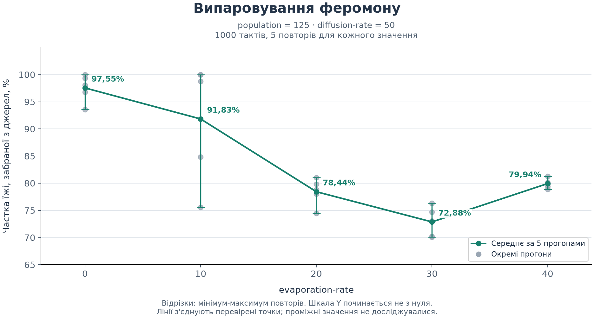
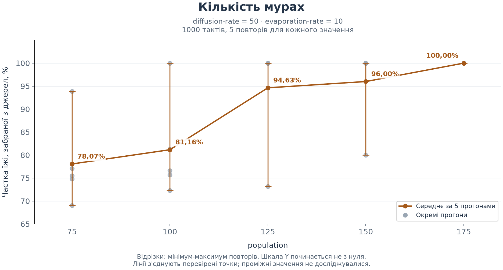

# Комп’ютерні системи імітаційного моделювання

## СПм-25-1, Нечітайло Олександр Віталійович

### Лабораторна робота № 1. Опис імітаційних моделей та проведення обчислювальних експериментів

**Варіант 10 - модель Ants.**

[Відкрити Ants у NetLogo Web](https://www.netlogoweb.org/launch#https://www.netlogoweb.org/assets/modelslib/Sample%20Models/Biology/Ants.nlogo) · [Опис моделі](https://ccl.northwestern.edu/netlogo/models/Ants) · [Первинні результати](results.md)

## Мета роботи

Ознайомитися з готовою агентною імітаційною моделлю Ants у середовищі NetLogo, описати її складові та правила поведінки агентів. Дослідити залежність збирання їжі від дифузії феромону, його випаровування та чисельності колонії за допомогою обчислювальних експериментів.

## Вербальний опис моделі

Ants відтворює пошук їжі колонією мурах. У центрі двовимірного середовища розташований мурашник, на різних відстанях від нього - три джерела їжі. Мурахи рухаються середовищем, знаходять їжу та повертаються з нею до мурашника, залишаючи феромон. Інші мурахи можуть орієнтуватися за концентрацією феромону, утворюючи спільні стежки.

У моделі немає агента, який планує роботу всієї колонії. Організована поведінка виникає внаслідок локальних дій багатьох мурах та їхнього впливу на середовище. Це приклад самоорганізації та непрямої взаємодії через зміни середовища - стигмергії.

Модель є комп’ютерною, динамічною, стохастичною та агентною. Модельний час змінюється дискретно: один виклик процедури `go` завершується збільшенням лічильника `ticks` на одиницю. Відповідність між тактом та реальною секундою не задана.

### Керуючі параметри

| Параметр | Зміст | Діапазон повзунка |
|---|---|---:|
| `population` | Кількість мурах, створених процедурою `setup` | 0-200 |
| `diffusion-rate` | Частка феромону, що перерозподіляється між сусідніми клітинками за такт, у відсотковому поданні | 0-99 |
| `evaporation-rate` | Відсоток феромону, який усувається під час випаровування за такт | 0-99 |

Дифузія перерозподіляє феромон у просторі, а випаровування зменшує його кількість. Зміна `population` застосовується до чисельності колонії під час нового `setup`.

### Внутрішні змінні та налаштування

| Змінна | Зміст |
|---|---|
| `food` | Кількість їжі на клітинці: на початку в джерелах випадково задається 1 або 2 одиниці |
| `chemical` | Концентрація феромону на клітинці |
| `nest?` | Ознака належності клітинки до мурашника |
| `nest-scent` | Незмінне поле запаху мурашника: `200 - distancexy 0 0` |
| `food-source-number` | Номер джерела їжі: 1, 2 або 3; поза джерелами - 0 |
| `xcor`, `ycor`, `heading` | Положення й напрямок руху мурахи |
| `color` мурахи | Червоний - пошук їжі; помаранчевий (`orange + 1`) - перенесення їжі |

До внутрішніх налаштувань належать: переміщення на 1 просторову одиницю за активний крок; додавання 60 одиниць феромону мурахою з їжею поза мурашником; перевірка запаху попереду та під кутами ±45°; випадкові повороти; радіус мурашника та кожного джерела менший за 5 одиниць.

Орієнтування шукача за феромоном запускається лише за умови `0.05 <= chemical < 2` на його поточній клітинці. Тому велика концентрація феромону не обов’язково посилює спрямований пошук. Мурахи виходять поступово: агент із номером `who` починає діяти, коли `ticks > who`.

### Алгоритм зміни станів

1. `setup` очищує попередній стан, створює мурах у центрі, мурашник та три джерела. Феромону спочатку немає, запас їжі на клітинках джерел задається випадково. Лічильник часу обнуляється.
2. Під час `go` активна мураха без їжі перевіряє поточну клітинку. Якщо їжа є, забирає одну одиницю, змінює стан і розвертається.
3. Якщо їжі немає та виконується умова чутливості, мураха порівнює феромон попереду та з боків і за потреби повертає в напрямку більшої концентрації.
4. Мураха з їжею поза мурашником залишає феромон і орієнтується за зростанням `nest-scent`. У мурашнику переходить до стану пошуку та розвертається.
5. До руху додаються випадкові повороти, після чого мураха переміщується. На межі світу напрямок коригується.
6. Після дій агентів виконується дифузія феромону, потім його випаровування та оновлення кольорів клітинок. Час збільшується на один такт.

Стежка підсилюється, коли нею повертаються нові мурахи з їжею: це позитивний зворотний зв’язок. Вичерпання джерела припиняє нові повернення з їжею з нього, а випаровування сприяє поступовому зникненню старого сліду.

### Показники роботи

Вбудований графік `Food in each pile` показує залишок їжі окремо в трьох джерелах. Для порівняння налаштувань у роботі використано **частку їжі, забраної з джерел за 1000 тактів**:

$$
P_{1000} = \frac{F_0-F_{1000}}{F_0}\cdot100\%,
$$

де **F₀** - початкова сума `food` за всіма клітинками, **F₁₀₀₀** - залишок після 1000 тактів. Значення **F₀ - F₁₀₀₀** - кількість забраної їжі в одиницях.

Для кожного значення параметра обчислено арифметичне середнє п’яти індивідуальних часток:

$$
\overline{P}_{1000}=\frac{1}{5}\sum_{i=1}^{5}P_{1000,i}.
$$

Нормування на початковий запас враховує те, що кількість їжі відрізняється між прогонами. Показник стосується їжі, забраної з джерел: частина її на момент вимірювання ще може перебувати в мурах дорогою до мурашника. Одиниці їжі також не тотожні кількості клітинок.

## Організація експериментів

У кожному експерименті змінювався один керуючий параметр; два інші залишалися сталими. Для кожного з п’яти значень виконано п’ять прогонів. Збережено стандартне розміщення мурашника й джерел; логіка моделі не змінювалася.

Перед кожним прогоном виконувалося `setup`. Початковий і кінцевий запаси отримувалися командою `sum [food] of patches`. Автоматизовані прогони виконувалися через `repeat 1000 [ go ]` за вимкненої кнопки безперервного запуску. Частину прогонів додатково спостерігали в анімації. У випадку раннього вичерпання джерел нульовий залишок зберігається й на 1000-му такті, оскільки їжа не поновлюється.

Базова серія `population = 125`, `diffusion-rate = 50`, `evaporation-rate = 10` використана і в першому, і в другому експериментах. Тому 75 записів у трьох таблицях первинних даних відповідають 70 окремим прогонам. Значення `random-seed` не фіксувалися; однакові випадкові початкові стани між різними налаштуваннями не забезпечувалися.

Серію за 125 мурах у третьому експерименті виконано окремо від базової серії перших двох експериментів. Її середнє становить 94,63%, тоді як у базовій серії за тих самих керуючих параметрів - 91,83%. Це різні п’ять прогонів стохастичної моделі; результати цих серій не змішувалися.

На графіках показано середні, окремі результати та діапазони мінімум-максимум. Ці діапазони не є довірчими інтервалами. Для дифузії шкала Y починається з 70%, для випаровування та популяції - з 65%, щоб прибрати порожню область і зберегти всі результати. Лінії лише з’єднують досліджені точки. Різниця між середніми описує отримані вибірки; статистична значущість окремо не перевірялася.

## Експеримент 1. Вплив дифузії феромону

**Початкові умови:** `population = 125`, `evaporation-rate = 10`; тривалість - 1000 тактів, п’ять повторів на значення. Досліджені значення `diffusion-rate`: 0, 25, 50, 75, 99.

Перевірялося припущення, що сильне розсіювання феромону робить стежку менш виразною й може погіршувати пошук їжі.

| `diffusion-rate` | Середнє P, % | Мінімум-максимум, % | Повне вичерпання джерел |
|---:|---:|---:|---:|
| 0 | 94,19 | 90,57-97,09 | 0 із 5 |
| 25 | 91,98 | 78,33-100,00 | 3 із 5 |
| 50 | 91,83 | 75,56-100,00 | 2 із 5 |
| 75 | 100,00 | 100,00-100,00 | 5 із 5 |
| 99 | 95,01 | 80,76-100,00 | 3 із 5 |

**Спостереження.** За дифузії 0 феромонний слід виглядав як тонка лінія. За 25 він був виразнішим, ніж за 50; в одному прогоні їжа закінчилася приблизно до 700-го такту. За 50 спочатку одночасно використовувалися близьке й середнє джерела, а пошук найдальшого затримувався. За 99 спостерігалося скупчення мурах в окремій точці після перенесення їжі. Причина цього скупчення окремо не перевірялася.

**Висновок.** Середні результати не змінювалися монотонно зі збільшенням дифузії. Найкращий результат серед перевірених значень отримано за 75: усі п’ять прогонів дали 100%. За 99 середнє становило 95,01%, за 0 - 94,19%. Ці два середні близькі, проте розкид за 99 більший.

Початкове припущення про постійне погіршення зі зростанням дифузії не підтвердилося. Дифузія може розширювати область виявлення сліду, але водночас змінює його концентрацію та просторову виразність. Візуальна ширина сліду сама по собі не визначає частку забраної їжі. Перевагу 25 над 50 також не встановлено: середні відрізняються лише приблизно на 0,15 відсоткового пункта при значному розкиді повторів. Глобально найкраще значення параметра цим експериментом не визначалося.

## Експеримент 2. Вплив випаровування феромону

**Початкові умови:** `population = 125`, `diffusion-rate = 50`; тривалість - 1000 тактів, п’ять повторів на значення. Досліджені значення `evaporation-rate`: 0, 10, 20, 30, 40. Постійний крок зміни параметра - 10.

Досліджувалося, як збереження й зникнення феромону пов’язані зі збиранням їжі. Для значення 10 повторно використано базову серію першого експерименту. Для 0, 20 і 40 використано раніше виміряні серії, для 30 виконано п’ять додаткових прогонів за тих самих фіксованих параметрів і тривалості.

| `evaporation-rate` | Середнє P, % | Мінімум-максимум, % | Повне вичерпання джерел |
|---:|---:|---:|---:|
| 0 | 97,55 | 93,55-100,00 | 1 із 5 |
| 10 | 91,83 | 75,56-100,00 | 2 із 5 |
| 20 | 78,44 | 74,45-81,05 | 0 із 5 |
| 30 | 72,88 | 70,10-76,32 | 0 із 5 |
| 40 | 79,94 | 78,91-81,29 | 0 із 5 |

**Спостереження.** За випаровування 0 поле поступово заповнювалося феромоном; ближче до 1000-го такту пошуковий рух виглядав менш спрямованим. За 40 було видно переважно коротку «ауру» навколо мурах із їжею, а тривалого сліду майже не спостерігалося.

**Висновок.** Серед перевірених значень найбільша середня частка забраної їжі отримана за випаровування 0 - 97,55%. Далі середнє зменшувалося: 91,83% за 10, 78,44% за 20 та 72,88% за 30. За 40 воно знову зросло до 79,94%, тому залежність у вибірці не є монотонною.

За значення 30 результати п’яти прогонів становили 70,10-76,32%; повне вичерпання джерел не спостерігалося. За 0 воно відбулося в одному прогоні з п’яти, за 10 - у двох, за 20 і 40 - у жодному.

Відсутність випаровування сприяє накопиченню феромону, що може знижувати контраст концентрацій і на частині клітинок виводити концентрацію за верхній поріг реакції шукачів. За виглядом поля не визначено, який механізм переважав. При цьому за обраним показником саме серія за 0 мала найбільше середнє серед перевірених точок.

Надто швидке випаровування ускладнює збереження тривалого сліду: за значення 40 після кожного такту випаровування залишається 60% феромону. Саме випаровування без нового внесення залишило б за 10 тактів близько 0,6% початкової кількості. Причина підвищення результату від 30 до 40 окремо не перевірялася; статистична значущість відмінностей не оцінювалася. Глобально найкраще значення випаровування цим експериментом не встановлено.

## Експеримент 3. Вплив кількості мурах

**Початкові умови:** `diffusion-rate = 50`, `evaporation-rate = 10`; тривалість - 1000 тактів, п’ять повторів на значення. Досліджені значення `population`: 75, 100, 125, 150, 175. Постійний крок зміни параметра - 25.

Перевірялося припущення, що більша колонія має більше можливостей знайти джерела, підкріплювати стежки та переносити їжу. Для 100 і 150 мурах використано раніше виміряні серії, для 75, 125 і 175 виконано по п’ять додаткових прогонів.

| `population` | Середнє P, % | Мінімум-максимум, % | Повне вичерпання джерел |
|---:|---:|---:|---:|
| 75 | 78,07 | 69,04-93,87 | 0 із 5 |
| 100 | 81,16 | 72,29-100,00 | 1 із 5 |
| 125 | 94,63 | 73,15-100,00 | 4 із 5 |
| 150 | 96,00 | 80,00-100,00 | 4 із 5 |
| 175 | 100,00 | 100,00-100,00 | 5 із 5 |

**Висновок.** Середня частка забраної їжі послідовно зростала в досліджених точках - від 78,07% за 75 мурах до 100% за 175. Залежність не є прямо пропорційною: однакове збільшення популяції на 25 дає різні прирости середнього результату. Діапазони окремих прогонів для сусідніх значень перекриваються, тому зростання середніх не означає покращення кожного окремого запуску.

Більша кількість мурах створює більше можливостей для випадкового знаходження їжі або феромонного сліду. Після знаходження джерела більше агентів можуть переносити їжу та частіше підкріплювати шлях. Отже, результат пов’язаний не лише з вибором напрямку пошуку, а й із перенесенням їжі та колективним підтриманням стежок.

За 75 мурах усю їжу не було забрано в жодному з п’яти прогонів, за 100 - в одному, за 125 і 150 - у чотирьох, за 175 - у всіх п’яти. Показник наблизився до верхньої межі 100%; для подальшого порівняння великих колоній доцільно вимірювати час до збирання заданої частки їжі. Продуктивність однієї мурахи в цьому експерименті не оцінювалася. Поступовий вихід мурах, закладений у коді, також є частиною досліджуваної поведінки колонії.

## Обмеження моделі та дослідження

- Повернення додому спирається на штучно задане поле запаху мурашника, яке не зникає та не потребує навчання агентів.
- Не моделюються витрати енергії, народження й загибель мурах, реалістичні перешкоди, фізичне блокування руху або складні способи навігації.
- Для підрахунку результату використано їжу, забрану з джерел. Залишок нуль не означає, що остання мураха вже донесла вантаж до мурашника.
- П’ять повторів характеризують спостережений розкид, але не гарантують відтворення тієї самої частоти повного збирання в новій серії. Початкові випадкові стани не контролювалися.
- Висновки стосуються заданої геометрії, перевірених параметрів і 1000 тактів. Комбінації найкращих значень із різних експериментів разом не перевірялися.
- Правдоподібний вигляд симуляції не доводить її кількісної адекватності реальній колонії. Зіставлення з натурними даними не проводилося.

## Загальні висновки

Під час роботи описано агентну модель Ants, її керуючі параметри, змінні стану та алгоритм поведінки. Проведено три обчислювальні експерименти з повторними прогонами та побудовано графіки залежності частки забраної їжі від параметрів.

Для дифузії найкращий спостережений результат отримано за 75 при популяції 125 та випаровуванні 10: усі п’ять прогонів дали 100%. Серед перевірених значень випаровування найбільше середнє отримано за 0 - 97,55% при популяції 125 та дифузії 50. Це результати окремих експериментів із різними фіксованими умовами; їх поєднання не перевірялося й глобальний оптимум не встановлено.

У рівномірній серії випаровування 0, 10, 20, 30, 40 середній результат зменшувався до значення 30, а за 40 зріс. У серії популяції 75, 100, 125, 150, 175 середня частка забраної їжі послідовно зростала від 78,07% до 100%. Це узгоджується зі збільшенням можливостей пошуку, перенесення їжі та підкріплення слідів. Залежність не є прямо пропорційною та обмежена запасом їжі.

Повторні прогони дозволили уточнити початкові припущення: результат одного запуску не завжди відображає типовий перебіг моделі. Спостереження за стежками допомагають пояснювати результати, але причинні пояснення слід відрізняти від безпосередньо виміряних залежностей.
